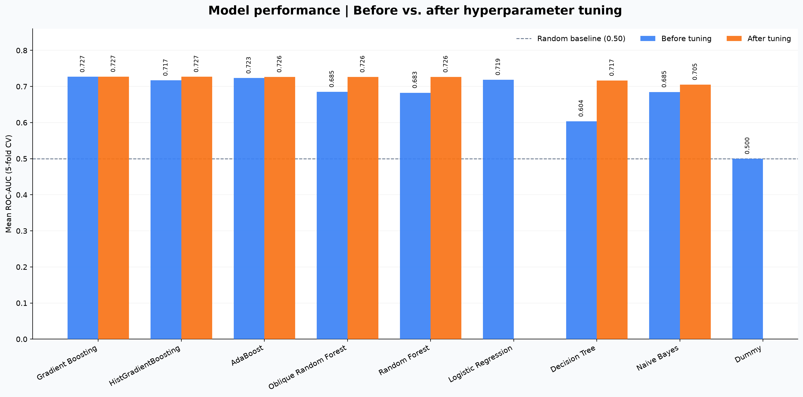
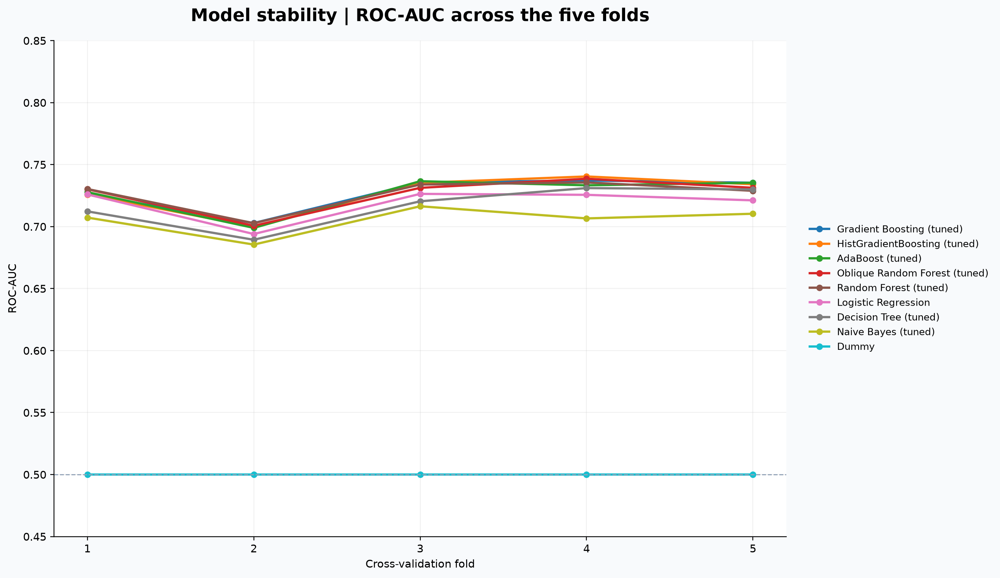

# Daniel Araújo 20260669

# Week 2 progress

The logistic regresion model is the better model, as it achieves a higher test accuracy (67.9%) compared to the decision tree (62.9%).It also shows no overfitting, with a 0.0% train-test gap, while the decision tree has a 20.0% gap. Additionally, its F1-score (0.67) is higher than the decision tree’s (0.62), indicating better overall performance and generalization.

# Week 3 progress

Before evaluating the performance of the models once again, changes were made to the "raw" dataset with the purpose of completing the data cleaning step. Taking in consideration that such changes were made it is natural that the results of each model change. Comparisons between models of the "raw" and "cleaned" datasets were not made.

### Model Performance on the Cleaned Dataset

| Model | Train Accuracy | Test Accuracy | Macro F1 | Train-Test Gap |
|---|---:|---:|---:|---:|
| Logistic Regression | 67.8% | 65.5% | 0.64 | 2.3% |
| Decision Tree | 79.9% | 60.6% | 0.59 | 19.3% |~

On the cleaned database, logistic regression performs better than the decision tree, with a test accuracy of 65.5% vs. 60.6%, an F1-score of 0.64 vs. 0.59, and a much smaller train-test gap (2.3% vs. 19.3%). In the previous results, logistic regression also performed better (67.9% vs. 62.9% accuracy) and had a smaller gap (0.0% vs. 20.0%). However, the results before and after cleaning should not be directly compared, since the models were trained and tested on different versions of the dataset. Therefore, the most meaningful comparison is between the two models within the same dataset.

# Week 4 progress

Updates
- Improved data cleaning with invalid values, placeholders, duplicates and missing-value handling.
- Preprocessing is now included inside the model pipeline.
- Replaced the single train/test split with 5-fold stratified cross-validation.
- Comparing Models.

### Model Comparison

The models were compared using the same 5-fold stratified cross-validation setup, with the same preprocessing pipeline and random state.

| Model | Train Accuracy | Test Accuracy | Macro F1 | Train-Test Gap |
|---|---:|---:|---:|---:|
| Logistic Regression | 67.5% | 67.2% | 0.66 | 0.3% |
| Decision Tree | 69.5% | 61.0% | 0.60 | 8.5% |
| Random Forest | 73.3% | 65.0% | 0.64 | 8.3% |

For now, I am comparing the models mainly using the mean validation accuracy, its standard deviation, and the train–validation gap. I am not completely sure whether this is the best model comparison approach for this project, so this should be confirmed with the professor.
Logistic Regression currently shows the best overall cross-validation performance. Random Forest still requires hyperparameter tuning, so its current results should be considered preliminary.

## Week 6

All five models were evaluated using stratified 5-fold cross-validation on the development set. Hyperparameter optimization was performed using Optuna with 30 trials, 5 inner folds and 5 outer folds for nested cross-validation. Accuracy was the evaluation metric, and the final 20% test set remained locked throughout model selection.

| Model | Default: CV mean ± std (gap) | Tuned: nested CV mean ± std (gap) | Tuning score (best trial) | Chosen hyperparameters |
|---|---|---|---|---|
| Logistic Regression | 0.672 ± 0.013 (+0.003) | 0.671 ± 0.015 (+0.005) | 0.677 | C=0.0746 |
| Decision Tree | 0.610 ± 0.018 (+0.085) | 0.672 ± 0.017 (+0.013) | 0.679 | max_depth=6, min_samples_leaf=101, criterion=gini |
| Random Forest | 0.650 ± 0.019 (+0.082) | 0.681 ± 0.015 (+0.009) | 0.683 | max_depth=22, min_samples_leaf=42, max_features=0.5 |
| Oblique Random Forest | 0.647 ± 0.011 (+0.114) | 0.679 ± 0.013 (+0.013) | 0.683 | max_depth=6, min_samples_leaf=3, n_components=5 |
| AdaBoost | 0.676 ± 0.012 (+0.006) | **0.682 ± 0.017 (+0.004)** | 0.684 | max_depth=4, n_estimators=220, learning_rate=0.0251 |

### Model comparison and selection

AdaBoost achieved the highest nested cross-validation accuracy (0.682 ± 0.017), closely followed by Random Forest (0.681 ± 0.015) and Oblique Random Forest (0.679 ± 0.013). However, these differences are small relative to fold-to-fold variability, so the results do not establish a statistically significant winner. The selected AdaBoost hyperparameters (depth 4, 220 estimators and learning rate 0.0251) are consistent with using moderately shallow trees and small boosting updates to control model complexity. AdaBoost is therefore our provisional preferred model based on its marginally higher estimated accuracy and small training-validation gap (+0.004). We would report its nested CV accuracy of **0.682 ± 0.017**, rather than the optimistic best-trial score of 0.684, while keeping the final test set untouched.

# Week 7 progress

## A. Expanded model benchmark and evaluation

This week, the pipeline was extended to benchmark **nine classification models** on the COMPAS two-year recidivism dataset: Dummy, Logistic Regression, Gaussian Naive Bayes, Decision Tree, Random Forest, Oblique Random Forest, AdaBoost, Gradient Boosting, and Histogram Gradient Boosting. The newly introduced model families include Gaussian Naive Bayes and both gradient-boosting variants. The benchmark uses the existing data-cleaning and preprocessing pipeline, with target encoding for categorical variables and robust scaling for numeric variables as specified in the Week 7 configuration.

The evaluation configuration now includes **accuracy, balanced accuracy, precision, recall, F1, F-beta (beta = 2), ROC-AUC, and average precision**. The primary selection metric was changed from accuracy (used in Week 6) to **ROC-AUC**. The evaluation workflow supports out-of-fold probability-based metrics, fairness reporting by the sensitive attribute (`race`), and nested cross-validation for tuned models. These are pipeline capabilities; the consolidated `runs.csv` supplied for this comparison contains ROC-AUC scores only, so the other metric values and fairness outcomes are not claimed here.

The development data were evaluated with **five stratified cross-validation folds**. For models with defined search spaces, hyperparameter optimization used **Optuna with 30 trials per search and five inner folds**; tuned model performance is reported using the nested cross-validation evaluation rather than the best-trial score. The final 20% hold-out test set was not used to rank the models in the results presented below.

## B. Experimental results and comparison

The batch runner completed **16 successful executions**: nine default configurations and seven tuned configurations. Dummy and Logistic Regression were evaluated without tuning in this batch because no corresponding Week 7 search spaces were configured. The scoreboard contained one additional, earlier Dummy entry, which was excluded from this comparison to avoid double counting.

### ROC-AUC results

Values are **mean ± standard deviation across the five evaluation folds**. A higher ROC-AUC indicates better discrimination between the positive and negative classes across classification thresholds. The improvement column is the tuned mean minus the default mean.

| Model | Default ROC-AUC | Tuned ROC-AUC | Improvement |
|---|---:|---:|---:|
| Gradient Boosting | 0.7267 ± 0.0148 | 0.7274 ± 0.0144 | +0.0007 |
| Histogram Gradient Boosting | 0.7169 ± 0.0197 | 0.7271 ± 0.0162 | +0.0102 |
| AdaBoost | 0.7232 ± 0.0163 | 0.7264 ± 0.0157 | +0.0032 |
| Oblique Random Forest | 0.6852 ± 0.0159 | 0.7264 ± 0.0148 | +0.0411 |
| Random Forest | 0.6826 ± 0.0184 | 0.7263 ± 0.0134 | +0.0437 |
| Logistic Regression | 0.7186 ± 0.0139 | — | — |
| Decision Tree | 0.6038 ± 0.0153 | 0.7166 ± 0.0170 | +0.1129 |
| Gaussian Naive Bayes | 0.6847 ± 0.0111 | 0.7052 ± 0.0117 | +0.0205 |
| Dummy | 0.5000 ± 0.0000 | — | — |

### Visual comparison

*Figure 1. Default and tuned mean ROC-AUC for each model. The dashed reference at 0.50 represents chance-level discrimination.*

*Figure 2. Fold-level ROC-AUC for each model, using its tuned configuration when available and its default configuration otherwise. This illustrates variation across folds, not a training-time learning curve.*

### Interpretation and model selection

**Tuned Gradient Boosting** achieved the highest mean ROC-AUC (**0.7274 ± 0.0144**), followed very closely by tuned Histogram Gradient Boosting (**0.7271 ± 0.0162**), tuned AdaBoost (**0.7264 ± 0.0157**), tuned Oblique Random Forest (**0.7264 ± 0.0148**), and tuned Random Forest (**0.7263 ± 0.0134**). Their differences are very small compared with fold-to-fold variation; this benchmark does **not** establish a statistically significant winner. Gradient Boosting is therefore the **provisional selection under the specified ROC-AUC criterion**, rather than a conclusively superior model.

Hyperparameter tuning improved the mean ROC-AUC of all seven tuned models. The largest gains were seen for **Decision Tree (+0.1129)**, **Random Forest (+0.0437)**, and **Oblique Random Forest (+0.0411)**. By contrast, Gradient Boosting improved by only **+0.0007**, suggesting that its default configuration was already competitive for this dataset. Logistic Regression, without tuning, achieved **0.7186 ± 0.0139**, making it a useful simpler baseline. The Dummy classifier scored **0.5000**, consistent with chance-level ranking performance.

### Why ROC-AUC was selected

ROC-AUC measures how well a classifier ranks positive cases above negative cases across possible decision thresholds, making it more informative than accuracy alone when the operating threshold has not yet been fixed. It is also useful for comparing models without choosing a particular balance between false positives and false negatives in advance. **However, ROC-AUC does not capture calibration, the costs of different errors, or disparities between demographic groups**, so average precision, threshold-dependent metrics, and fairness diagnostics should also be reviewed before deployment.

### Complementary batch execution script

As a complementary addition to the Week 7 pipeline, we included **`run_all_week7.py`** to run the complete model benchmark in a single command instead of launching each experiment manually. The script executes the nine default model configurations and the seven models with configured hyperparameter search spaces, using the same evaluation settings and **30 Optuna trials per tuning search**. It records each run in the scoreboard (`results/runs.csv`), saves execution logs and a status summary under `results/week7_logs/`, and restores the original `config.yaml` after the batch finishes. This makes the experiments easier to reproduce and compare while leaving the existing single-model workflow in `main.py` available.

### Reproducing the results and figures

Run `python run_all_week7.py` from the repository root to execute the benchmark, then run `python plot_model_dashboard.py` to generate the plots from `results/runs.csv`. The benchmark's execution status is recorded in `results/week7_logs/execution_status.csv`, and the chart script writes figures into `results/plots/`. Because `results/` is ignored by Git, the two PNG files must be explicitly added with `git add -f` for the figures to display on GitHub.

**Scope of these conclusions:** The table and figures are based on the recorded cross-validation ROC-AUC values in `runs.csv`, not on the untouched hold-out test set. No precision–recall or ROC curves are presented because their construction requires per-observation out-of-fold or held-out predicted probabilities and true labels, not just aggregate fold scores. Likewise, the remaining seven metrics and group fairness statistics require the corresponding evaluation outputs for a quantitative comparison.
